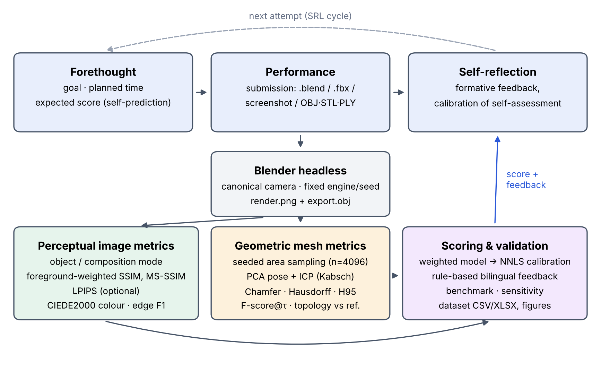

# CG-SDL-AAF

**A Reproducible Automated Assessment Framework for Self-Directed Learning in Computer Graphics**

*Kompyuter grafikasida mustaqil ta'lim uchun takrorlanuvchan avtomatik baholash ramkasi*

[O'zbekcha](#ozbekcha) · [English](#english)



---

## O'zbekcha

### Nima qiladi
Talabalarning «Kompyuter grafikasi» fanidan mustaqil ishlarini (render tasvirlari va 3D modellar) etalon bilan solishtirib, **avtomatik baholaydi** va **formativ izoh** beradi. Har bir urinish mustaqil ta'lim (o'z-o'zini boshqarish) sikli bo'yicha qayd etiladi: **rejalashtirish → bajarish → refleksiya**. Ekspert baholari bilan **validatsiya**, **kalibrlash** va **o'quv analitikasi** maqola uchun tayyor jadval va rasmlar ko'rinishida chiqariladi.

| Modul | Metrikalar |
|---|---|
| Tasvir | og'irlikli SSIM, MS-SSIM, LPIPS (AlexNet), CIEDE2000 rang farqi + HSV gistogramma, Sobel kontur F1 |
| 3D model | Chamfer, Hausdorff, Hausdorff-95, F-score@τ, topologiya (teshik, non-manifold, degeneratsiya) |
| Blender | `.blend` / `.fbx` fayllarni standart kamera bilan qayta render qilish va OBJ eksport (oynasiz) |
| Statistika | Pearson/Spearman, ICC(2,1)/(3,1), Bland–Altman, kvadratik κ, bootstrap CI, NNLS kalibrlash, LOOCV ablatsiya |

### O'rnatish (Windows)
1. [Python 3.10–3.13](https://www.python.org/downloads/) o'rnating («Add to PATH» belgisini qo'ying).
2. [Blender](https://www.blender.org/download/) (3.6 yoki yangiroq) o'rnating — `.blend` fayllar uchun.
3. Papkada buyruq oynasini oching:
   ```
   pip install -e .[lpips]
   cgaaf-gui
   ```
   LPIPS birinchi ishga tushishda AlexNet og'irliklarini (≈ 230 MB) internetdan yuklaydi.
4. Tayyor `.exe` kerak bo'lsa: `build_windows.bat` → `dist\CG-SDL-AAF\CG-SDL-AAF.exe`.

### Ishlash tartibi
1. **Kurs yaratish** — «Yangi kurs yaratish» (yoki sinov uchun «Namuna (sintetik) kurs»).
2. **Topshiriq qo'shish** — tur (tasvir / 3D / ikkalasi), etalon: PNG, OBJ/STL yoki `.blend` (eng yaxshisi — `.blend`: etalon ham talaba ishi bilan aynan bir xil usulda render qilinadi).
3. **Talaba** — «Talaba (mustaqil ish)» oynasida reja (maqsad, vaqt, kutilgan ball) → fayl → natija va izoh → refleksiya.
   Yoki talabalar ishlarini `submissions/<talaba_ID>/<topshiriq_ID>/<urinish>/` papkasiga joylab, «Guruhni baholash».
4. **Ekspert baholari** — ko'r baholash oynasi (avtomatik ball ko'rsatilmaydi) yoki Excel shablon → import.
5. **Validatsiya va hisobot** — `results/validation_*` papkasida: `report_uz.md`, `report_en.md` (maqola uchun inglizcha natijalar paragrafi), `tables.xlsx`, 300 dpi PNG + PDF rasmlar.
6. **Kalibrlash** — ekspert baholari asosida ball modeli (NNLS) topshiriqqa qo'llanadi.
7. **Eksport** — SPSS/R/Python uchun `dataset.csv` / `dataset.xlsx` (anonim kodlar bilan).

### Maqola uchun (2-variant: benchmark + arxiv ma'lumotlari)
«Maqola (benchmark + arxiv)» oynasi yoki buyruq qatori:
```
cgaaf archive-template D:\arxiv --out arxiv_jadval.xlsx      # 1) arxivdagi fayllar ro'yxati
   (jadvalda talaba_ID, topshiriq_ID, urinish, expert1, expert2 ni to'ldiring)
cgaaf import-archive kurs arxiv_jadval.xlsx --expert-max 5    # 2) import + baholash (5 ballik → 0–100)
cgaaf benchmark kurs\results\benchmark                         # 3) boshqariladigan benchmark (+ Blender testlari)
cgaaf paper kurs --benchmark kurs\results\benchmark            # 4) barcha jadval, rasm va natija paragraflari
```
Natija: `paper_results_en.md` (I–VII jadvallar, inglizcha paragraflar), `paper_tables.xlsx`, `figures/` (300 dpi PNG + PDF).

Batafsil: [docs/QOLLANMA_uz.md](docs/QOLLANMA_uz.md) · Metodika: [docs/METHOD_en.md](docs/METHOD_en.md)

---

## English

### What it does
Automatically assesses students' independent Computer Graphics work (renders and 3D models) against a reference and returns formative feedback. Each attempt is logged along the self-regulated learning cycle (**forethought → performance → self-reflection**). Validation against expert ratings, calibration and learning analytics are exported as publication-ready tables and figures.

### Install
```bash
pip install -e .[lpips]      # or: pip install -e .   (without LPIPS)
cgaaf-gui                    # desktop application (UZ/EN)
cgaaf --help                 # command line
```
Blender (≥ 3.6) is needed only for `.blend`/`.fbx` submissions; it is found automatically or via `CGAAF_BLENDER=/path/to/blender`.

### Command line
```bash
cgaaf init course --name "Computer Graphics 2025-2026"
cgaaf add-task course --id T1 --type both --ref-blend reference.blend --title-en "Lit scene" --deadline 2026-12-01
cgaaf submit course --student S001 --task T1 work.blend --goal "match lighting" --minutes 60 --pred 80
cgaaf evaluate course                     # batch: everything in submissions/ without result.json
cgaaf expert-template course              # blind rating sheet (xlsx)
cgaaf expert-import course ratings.xlsx
cgaaf validate course --task T1           # report + figures in course/results/
cgaaf calibrate course --task T1 --apply
cgaaf analytics course
cgaaf export course
cgaaf demo demo_course                    # SYNTHETIC sample (testing only)
```

### Technical-validation paper (benchmark only, no student data)
```bash
pip install -e .[lpips]                      # Blender 3.6+ installed, or CGAAF_BLENDER=/path/to/blender
cgaaf benchmark benchmark_full --repeats 3   # image, mesh, Blender render-level, robustness, AUC vs baselines
cgaaf paper --benchmark benchmark_full --out paper_tech
```
or simply `scripts/run_full_benchmark.bat` (Windows) / `scripts/run_full_benchmark.sh`.
Output: `paper_tech/paper_results_en.md` (all tables + results paragraph), `paper_tables.xlsx`, `figures/` (300 dpi PNG + PDF).

### Manuscript workflow with classroom data (benchmark + retrospective validation)
```bash
cgaaf archive-template ./archive --out mapping.xlsx        # list archived files; fill student_id, task_id, attempt, expert1, expert2
cgaaf import-archive course mapping.xlsx --expert-max 5    # copy, rescale grades to 0-100, assess
cgaaf benchmark course/results/benchmark                   # perturbation benchmark, Blender determinism & viewpoint test
cgaaf paper course --benchmark course/results/benchmark    # Tables I-VII, figures, results paragraphs
```
`docs/benchmark_reference_run/` contains the reference run of version 1.4 reported in the manuscript (Blender 5.3, LPIPS off because its network weights could not be downloaded in the build environment); `scripts/run_full_benchmark.*` reruns it, with LPIPS when the weights are available.

### Version 1.4 — revision after peer review of the technical validation
* image channel: explicit **object mode** (trim on, default: placement and size not assessed) and **composition mode** (trim off); both are benchmarked (v1.3 benchmarked trim off only, which did not match the default of a task);
* fair alignment baselines: Chamfer without alignment is now computed with both shapes in their original orientations (v1.3 compared an unrotated student cloud with a PCA-rotated reference); new baselines ICP only, PCA only, D2 shape distribution, FLIP and SNCD;
* topology is penalised only in excess of the reference; helper-component rule independent of the face count (subdivided floors, slabs) that keeps small thin model parts;
* viewport detection for light themes; robust background estimate; trimming ignores stray border lines;
* Blender runs with `--disable-autoexec` / `use_scripts=False` (no code in student files is executed);
* benchmark: 12 compositions (6 held-out), student-like render settings, re-tessellation, viewport (Workbench) screenshots, 512 px check, feedback validation, paired bootstrap AUC differences, leave-one-object-out ranges, sensitivity analysis of all default constants;
* feedback: the benchmark now validates every message against the injected error; two defects it exposed were corrected (no contour at all → "missing contours"; a result graded below 5 without a specific message always names the region with the largest difference or the overall shape);
* `scripts/paper/make_figures.py` and `scripts/paper/manuscript_numbers.py` regenerate Figs. 2–7 and the table rows of the manuscript from a benchmark run; `scripts/time_framework.py` times the framework metrics without the baselines;
* tests extended (light-theme crop, paired AUC difference, render settings neutralised, feedback corrections) — 28 tests.

Main findings of the reference run (`docs/benchmark_reference_run/`, 6,225 cases): the score decreased with severity in every error family and separated nuisance from errors with AUC 0.936 (object mode), 0.916 (composition mode) and 0.972 (meshes), without degradation on the six held-out compositions; **PSNR and the Hausdorff distance were slightly but significantly better** than the composite; canonical re-rendering reached AUC 0.975 and gave every correct scene the top grade, whereas **render and viewport screenshots were near chance** (0.550 and 0.511) — assess `.blend` files, not screenshots; the extra-parts message is unreliable and light-theme screenshot cropping fails. See `CHANGELOG.md` and the manuscript for details.

### Version 1.3 — technical-validation benchmark
* six parametric Blender compositions (Suzanne, chair, mug, desk lamp, still life with procedural texture, torus + cube) and their exported meshes as references;
* explicit nuisance families vs error families in every channel; AUC / Cohen d with reference-cluster bootstrap CIs for the framework and every baseline;
* render-level benchmark comparing the screenshot and the Blender re-render pipelines;
* `cgaaf paper --benchmark DIR` works without a course; full-run scripts with LPIPS.

### Version 1.2 — fixes after code review
* automatic removal of the Blender/3ds Max interface from screenshots (+ manual crop in the GUI and a `crop` column in the archive sheet);
* helper objects (floors, backdrops) excluded from mesh comparison and camera framing (`objects`: auto / names / collection / all);
* animation assessment at K frames (`frames`); optional absolute-size check (`check_size`);
* expert grades: `--expert-min`, `--expert-scale grade5` (2–5 grades → band centres);
* validation on one attempt per student and task, student-cluster bootstrap CIs;
* several screenshots per attempt → best match; library + Blender versions stored in every `result.json`; `requirements-lock.txt`.
Known limitations: see `docs/METHOD_en.md` § 9.

### Reproducibility
* Fixed seeds (surface sampling, Cycles), fixed canonical camera, versioned algorithm (`ALGO_VERSION` stored in every result).
* `result.json` is re-computable from the stored submission files; `submission.json` keeps the student-entered SRL data.
* `pytest tests/` — unit tests (incl. ICC against Shrout & Fleiss 1979 reference values and a full Blender re-render test).
* `notebooks/` reproduce all validation, ablation and learning-analytics tables and figures.

### Citation
See `CITATION.cff`. Licence: MIT.

> **Note.** The demo course is **synthetic** and exists only to exercise the software; its numbers must not be reported as empirical results.
